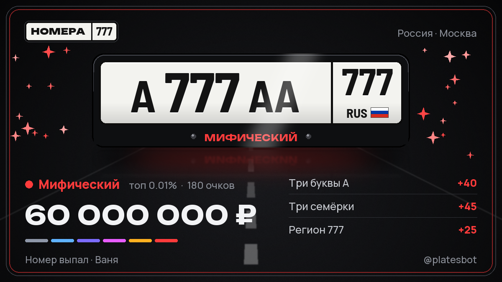

# Номера — Telegram-бот с мини-апой для прокрутки номерных знаков

Крутишь — выпадает номер (российский или любой из 19 стран), движок оценивает редкость,
очки, «топ X%» и цену. Лучшие номера сохраняются в гараж. Есть живая лента (каждую
секунду новый номер мира), и inline-режим для любого чата.



## Что внутри

| Часть | Файлы |
|---|---|
| Генератор номеров 19 стран | `core/plates.py` |
| Оценка редкости и цены | `core/rarity.py` |
| Мини-апа (без сборки) | `webapp/index.html`, `webapp/app.js`, `webapp/styles.css` |
| Кастомные TGS-иконки (Lottie) | `tools/make_icons.py` → `webapp/icons/*.tgs` |
| Бот (тонкий клиент Bot API, long polling) | `platesbot/tg.py`, `platesbot/handlers.py` |
| HTTP-сервер мини-апы и API, лента SSE | `platesbot/api.py` |
| PNG-карточки для чата и inline | `platesbot/render.py` |
| Оценка нейросетью (Claude, опционально) | `platesbot/ai.py` |
| SQLite | `platesbot/storage.py` |

Бот написан без сторонних библиотек. Клиент в `platesbot/tg.py` вызывает любой метод
Bot API как `await tg("method", param=value)`.

## Запуск

```bash
pip install -r requirements.txt
cp .env.example .env     # вписать BOT_TOKEN и PUBLIC_URL
python run.py
```

Для мини-апы и inline-карточек нужен https-адрес сервера. Локально проще всего через ngrok:

```bash
ngrok http 8080
```

и в `.env`: `PUBLIC_URL=https://xxxx.ngrok-free.app`. Кнопка меню «Крутить» и web_app-кнопки
настраиваются ботом автоматически при старте.

В BotFather: включить inline-режим (`/setinline`). Inline feedback не нужен: номер падает по кнопке «Крутить» под инлайн-сообщением, по желанию задать название мини-апы
(`/newapp`) — тогда ссылка вида `t.me/<bot>/<app>` тоже будет работать.

### Docker

```bash
cp .env.example .env     # вписать BOT_TOKEN и PUBLIC_URL
docker compose up -d --build
```

Внутри контейнера сервер слушает порт 3000, снаружи он доступен на 8080. База игроков хранится в томе `plates-data` и переживает пересборку.
Логи: `docker compose logs -f`. Без токена можно запустить только мини-апу:
`docker run --rm -p 8080:8080 -e DEV_MODE=1 $(docker build -q .)`.

### Bothost

Пакет называется `platesbot`, а не `bot`: Bothost монтирует свою папку в `/app/bot`, и пакет с таким именем перестаёт находиться (`No module named 'bot.main'`).


1. Создать бота из репозитория и включить «Использовать собственный Dockerfile», иначе хостинг может принять проект за Node из-за файлов `.js`.
2. В переменных окружения указать `BOT_TOKEN` и `PUBLIC_URL` — домен бота из панели, например `https://bot-xxx.bothost.tech`, без слеша на конце.
3. `PORT` хостинг подставляет сам из поля «Порт» (по умолчанию 3000), менять ничего не нужно.
4. База игроков должна лежать вне папки с кодом, иначе стирается при каждом обновлении. Бот сам выбирает
   постоянную папку: `DATA_DIR`, если задана, иначе `/data`, `/var/data` или `/persistent`, если они есть.
   После передеплоя в логе работы смотри строку `База: …, игроков N` — если игроков 0, данные не сохранились.

### Только мини-апа в браузере (без бота)

```bash
python run.py --dev
```

Открыть `http://localhost:8080`. В dev-режиме API принимает запросы без подписи initData.

## Как это играется

- **Энергия**: 30 бросков, +1 каждые 90 секунд (`ENERGY_MAX`, `ENERGY_REGEN_SEC`).
  Энергию можно докупить за Telegram Stars: команда `/energy` в чате, кнопки под сообщением
  «Энергия кончилась» или мини-апа. Наборы по умолчанию: +30 за 15 Stars, +100 за 40, +300 за 100
  (`ENERGY_PACKS` — JSON-список `{"id", "amount", "stars"}`; при ошибке в JSON берутся значения по умолчанию).
  Купленная энергия добавляется сверх максимума и не сгорает; восстановление идёт только пока
  запас ниже максимума.
  API для мини-апы: `/api/bootstrap` отдаёт `energy_packs`, `POST /api/energy/buy` с `{"pack": "s"}`
  возвращает `{"invoice_url": ...}` (в dev-режиме без бота начисляет сразу: `{"ok": true, "energy": {...}}`),
  `GET /api/energy` — текущая энергия `{"current", "max", "next_in"}`.
- **Гараж**: 5 бесплатных мест, несохранённые номера сгорают через 24 часа.
  Когда гараж полон, можно сохранить номер «навсегда» за Stars (`STARS_FOREVER`, 0 — выключить).
- **Страны**: Россия / весь мир / выбранные. Настройка общая для мини-апы и чата.
- **Оценить свой номер**: в мини-апе, в чате (просто напиши `А777АА 777`) и inline.
- **Нейросеть**: с `ANTHROPIC_API_KEY` в результате появляется кнопка «Оценка нейросети»
  (модель `AI_MODEL`, по умолчанию `claude-opus-5-5`), ответы кэшируются.

## Продажа номеров и гараж

- Редкий номер можно продать боту за прокруты (энергию): кнопка «Продать за N ⚡» под карточкой
  в личке и в группе, в гараже (`/garage` и мини-апа) и под результатом в мини-апе.
- Цены по редкости (`SELL_PRICES`): необычный 1, редкий 3, эпический 10, легендарный 40, мифический 150.
  Обычные номера не выкупаются. В среднем бросок приносит при продаже ~0,3 прокрута — меньше своей цены,
  поэтому бесконечной энергии не получится.
- Продать можно только свой номер и только один раз. Громкие продажи (от 10 прокрутов) в группе бот объявляет.
- Ненужные номера удаляются из гаража кнопкой 🗑 с подтверждением — место освобождается.

## Деньги и машины

- Любой номер можно продать за деньги — за его оценку в рублях (обычный уходит за 1 000 ₽). Это отдельная
  кнопка рядом с продажей за прокруты: номер продаётся либо за одно, либо за другое.
- На деньги покупаются машины (`/cars` в боте, «Автосалон» в гараже мини-апы): от ВАЗ-2107 за 60 000 ₽
  до Bugatti Chiron за 350 000 000 ₽. Каталог — `core/cars.py`.
- Машина, в которой игрок «за рулём», появляется на карточках его номеров (личка, группы, инлайн)
  и в гараже мини-апы — реальной фотографией.
- Фотографии взяты с Wikimedia Commons под свободными лицензиями, авторы и лицензии — в
  `assets/cars/CREDITS.md`. Скачать заново или заменить снимок: `python tools/fetch_car_photos.py`.

## Склад картинок

Приватный канал, куда бот складывает карточки и берёт их `file_id`. Тогда инлайн-обложки и карточки
не скачиваются Telegram'ом с нашего сервера, а берутся из Telegram — быстрее и работает, даже если
`PUBLIC_URL` недоступен. Подключается в `/admin` → «Склад картинок»: сделать бота админом канала и
переслать оттуда любой пост (или прислать id). Без склада всё работает по ссылке, как раньше.

## Группы

Бота можно добавить в любой чат:

- `.ролл`, `.спин`, `.номер` (а также `.roll`, `.spin`, `/roll`) — бросок прямо в чат, карточка приходит ответом.
  Под ней «В гараж» (только для автора), «Крутить свой» и «Открыть бота».
- При добавлении бот присылает приветствие с анимацией прокрутки.
- Раз в `GROUP_NUDGE_EVERY` сообщений (по умолчанию 100) бот отвечает кому-нибудь: «напиши .ролл».
- Чтобы не упереться в лимит Telegram (~20 сообщений в минуту на группу), бросок в группе — не чаще раза в 3 секунды,
  а одним игроком — раза в 8 секунд.

**Важно:** команды с точкой и счётчик сообщений работают, только если в @BotFather выключен privacy mode:
`/setprivacy` → бот → `Disable`. После этого бота нужно удалить из группы и добавить заново.
Команда `/roll` работает и без этого.

## Админка

`/admin` (или кнопка «Админка» в главном меню) — для id из `ADMIN_IDS`. Устроена как в mogbattle и «Итогах года»:

- **Спонсоры.** Каналы с обязательной подпиской (бот должен быть админом канала) и ссылки без проверки.
  У канала можно задать цель вступлений: набрав её, бот сам снимет канал и напишет админам.
  Пока человек не подписан, бот, мини-апа и инлайн-кнопка «Крутить» просят подписаться.
- **Статистика** и отчёт по спонсорам. Отчёт ещё и приходит сам раз в сутки в `REPORT_HOUR` по Москве.
- **Рассылка** любого сообщения всем, кто не заблокировал бота.
- **Премиум-эмодзи.** Ссылка вида `t.me/addemoji/tgiosicons` — пак применяется сразу, без перезапуска.
- **Баннер меню.** Своя картинка, GIF или видео вместо стандартной анимации прокрутки А777АА 777 (`assets/brand/spin.mp4`, перерисовать: `python tools/make_promo.py`).

## Премиум-эмодзи и цветные кнопки

Прослойка в клиенте (`platesbot/emoji.py`): обычные эмодзи в HTML-текстах, подписях и
инлайн-сообщениях становятся премиальными из пака, эмодзи в начале кнопки уезжает в её иконку
(`icon_custom_emoji_id`). «Открыть приложение», «Сохранить в гараж» и «Крутить» — синие (`style`).
Если Telegram не пускает премиум-эмодзи или цвет у этого бота, бот сам откатывается на обычные.

## Иконки

Все иконки — Lottie-анимации, собранные скриптом и сжатые в TGS (как стикеры Telegram),
без эмодзи. Перегенерация: `python tools/make_icons.py`. На фронте они красятся через
CSS `currentColor`, поэтому один файл работает и для активного, и для неактивного состояния.

## Дизайн мини-апы (версия 2)

- Шрифты лежат локально в `webapp/fonts` (Manrope, Unbounded, Barlow для символов номера), Google Fonts не нужен.
- Номер рисуется одним компонентом в любом масштабе: сцена, лента, гараж, обучение. Ширина ячеек фиксирована, символы не съезжают.
- Сцена с параллаксом: наклон телефона или движение пальца наклоняет номер, двигает блик, тень и дальний план.
- Первый запуск: экран загрузки, выбор языка (ru, en, uk, de, es, tr) и три слайда обучения. Повторить можно из раздела «Страны».
- Шрифты Manrope, Unbounded и Barlow распространяются по лицензии SIL OFL (файл OFL.txt рядом со шрифтами).
- Круглые флаги: circle-flags (MIT). Объёмные PNG: Microsoft Fluent Emoji 3D (MIT). Лежат в `webapp/img`.
- Причины редкости приходят с сервера на русском и пока не переводятся.

## Оформление бота

- Описание и короткое описание (ru и en) лежат в `platesbot/texts.py`, бот выставляет их сам при запуске.
- Аватарка и картинка описания: `assets/brand/`. Перерисовать: `python tools/make_brand.py`.
- Аватарку ставят в @BotFather командой `/setuserpic` (файл `avatar_640.png` или `avatar_1024.png`),
  картинку описания — командой `/setdescriptionpic` (файл `banner_640.png`, 640x360).
